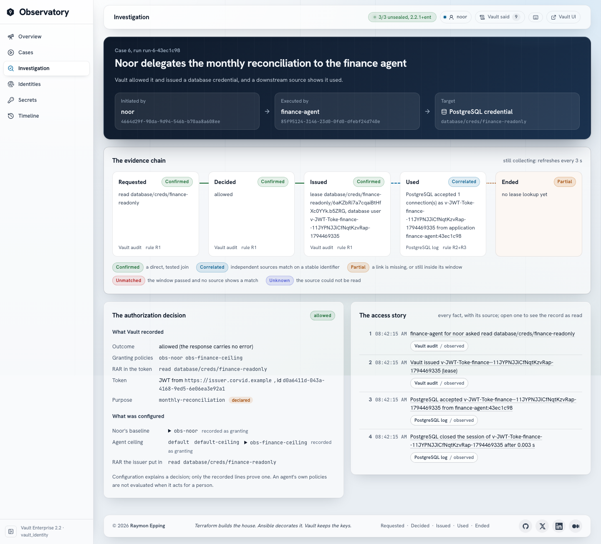

# vault_identity: Who Used the Secret?

Identity evidence on Vault Enterprise 2.2, on one Mac with Podman. A human, a
workload, an AI agent acting as itself and an agent acting for a person each
ask Vault for a KV secret or a PostgreSQL credential; the Identity
Observatory follows each request from the identity that asked, through
Vault's decision and what it issued, to the PostgreSQL session that used it,
and says how strong each link of that chain is.

> **Terraform builds the house. Ansible decorates it. Vault keeps the keys.
> Make is the front door.**



## What it proves, and what it only illustrates

**Proves:** Vault records who requested a secret and what it decided; for an
agent acting on behalf of a person (Agentic IAM: an OAuth resource server
profile, RAR, the Agent Registry) it records the person and the agent
separately and names the policies that granted it, or the ceiling or RAR
that refused it; PostgreSQL records who connected; joining the two by stable
identifiers (the generated username, the run's correlation id) shows who
used a credential, and the console says how strong each join is
(Confirmed, Correlated, Partial, Unmatched, Unknown). Revoking a credential
drops its role and privileges but does not close a session that is already
open. Every claim is measured in [docs/capabilities.md](docs/capabilities.md).

**Illustrates only:** Corvid Ledger, its people and its values are invented;
the lab's own issuer stands in for an enterprise identity provider; one
presenter runs every principal from the console (the stage-hand shortcut,
[docs/security-model.md](docs/security-model.md)); one Mac is not production.

## The cases

| # | Case | Who asks | Vault answers |
| --- | --- | --- | --- |
| 1 | Noor reads the reconciliation API key | a person (userpass) | allowed |
| 2 | Noor requests database credentials and runs a query | a person | allowed |
| 3 | The ledger agent reads the API key on its own | an agent as itself (JWT) | allowed |
| 4 | The ledger agent requests database credentials | an agent as itself | allowed |
| 5 | Noor delegates the API key read to the finance agent | an agent for a person | allowed |
| 6 | Noor delegates the monthly reconciliation | an agent for a person | allowed |
| 7 | Noor delegates the payroll export | an agent for a person | `CEILING_POLICY_DENIED` |
| 8 | The finance agent asks for credentials with a token scoped to the key | an agent for a person | `RAR_NO_MATCH` |
| 9 | payments-batch requests credentials and never connects | a workload (AppRole) | allowed, then Unmatched |
| 10 | A session outlives its revoked credential | an agent as itself | allowed, then revoked |

The story and the evidence rules: [docs/STORY.md](docs/STORY.md),
[docs/evidence-model.md](docs/evidence-model.md).

## Prerequisites

- macOS on Apple Silicon, Podman 6 with a running machine (8 GiB or more).
  Disk: about 1.7 GB (measured 2026-11-12: vault-enterprise 571 MB,
  postgres 294 MB, the api and web images 236 MB, node, nginx and alpine
  242 MB, the volumes 270 MB), plus Playwright's Chromium for `make test-ui`.
- Terraform 1.14, ansible-core 2.21, Node 24 or later, `jq`, `openssl`,
  `shellcheck` (for `make lint`).
- A Vault Enterprise licence with Namespaces and Agentic IAM:
  `VAULT_LICENSE` in `.env`.

## First run

```bash
make env-init          # .env from .env.example; put VAULT_LICENSE in it
make license           # installs it to .secrets/vault/vault.hclic, never printed
make lab               # every phase, then the gates (about three minutes)
make people-copy-password   # Noor's password on the clipboard, never printed
```

Then open the console at <https://localhost:14001/> and sign in as `noor`.
The lab CA is in no browser's trust store: `make trust-root` adds it to the
macOS keychain (sudo), or accept the warning.

`make up` on a lab that was never built runs `make lab` itself, so the
Lab Index (vault_lab_index) Start button works from nothing.

## Daily

```bash
make up                # or the Lab Index's Start: everything back, volumes kept
make down              # or its Stop: every container stops, every volume stays
make show-ready        # five minutes before a talk: up, fresh stage, verify
make stage-reset CONFIRM=yes   # after a rehearsal: credentials revoked, evidence store emptied
make doctor            # what is wrong, and which command fixes it
```

## Checks

| Command | What it proves |
| --- | --- |
| `make verify` | 79 checks: the cluster, the platform, the stage, PostgreSQL (TLS only), the app, the console, the token boundary, drift, idempotency, a secret scan and `make rehearsal` |
| `make rehearsal` | 56 checks through the console: all ten cases with their chain states, and every way they must fail |
| `make boundary` | 62 checks: each tool token, Noor, the workload and the console token may do their job and nothing else |
| `make test-ui` | 24 Playwright tests: cases from the UI, axe WCAG 2.1 AA on every page (desktop and phone), TLS and CSP |
| `make probe` | 59 cases in a scratch namespace: what Vault 2.2.1 and PostgreSQL 17 actually do |
| `make test-unit`, `make lint` | unit tests (57) and static checks, no stack needed |

## Ports (127.0.0.1)

| Service | Address |
| --- | --- |
| Console | <https://localhost:14001/> |
| API (behind the console) | <https://localhost:14001/api/healthz> |
| vault-1 to vault-3 | <https://localhost:19501/ui>, 19502, 19503 |
| vault-s (the seal Vault) | <https://localhost:19500> |

PostgreSQL and the API are not published on their own: the API answers only
behind the console's TLS, PostgreSQL only inside `vid-internal` and only over
TLS 1.3. Every container, compose project and volume carries the prefix
`vid-`.

## Where things are

- `Makefile`, `scripts/`: every operation; `scripts/phases.txt` is the only
  phase list.
- `terraform/vault-seal`, `terraform/vault-platform`: the declared structure
  (namespace `observatory`, auth, mounts, policies, entities and aliases, the
  OAuth profile, the Agent Registry, audit devices).
- `ansible/`: order and moment (init, tokens, the database, credentials,
  the stage, validate).
- `config/cases.json` (the cases, principals, labels), `config/defaults.conf`.
- `vault/`: server HCL and bootstrap policies.
- `api/` (Node 24, one dependency: `pg`), `web/` (React 19 + Vite, Vault
  daylight glass), `e2e/` (Playwright).
- Docs: [architecture](docs/architecture.md), [operations](docs/operations.md),
  [security model](docs/security-model.md), [evidence model](docs/evidence-model.md),
  [ownership](docs/ownership.md), [capabilities](docs/capabilities.md),
  [design](DESIGN.md), [state](docs/STATE.md).

## Licence

[GPL-3.0](LICENSE).
